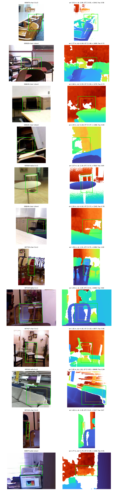

<!-- GENERATED by scripts/tune_depth.py from benchmarks/geometry/tune_val.json. Do not edit by hand; gallery categories live in docs/depth_tuning_review.yaml. -->

# Depth parameter tuning on SUN RGB-D val (spec 03.3)

**Measured** on `sunrgbd_val` (528 images). Test split not used (R8 guard). All errors in cm. Status rule and estimator: spec 03.1; centres: spec 03.2.

## Linkage (R1)

- `has3d` order check over all val images: counts equal in 518/528 images; projected-3D vs 2D IoU ≥ 0.5 for 2145/3044 pairs (fixed check fails), and the has3d pair is the best projection match for 2829/3044.
- 2D GT boxes are visible extents, projected 3D boxes are amodal, so IoU is often < 0.5 for a correct pair. Per R1 the **projection linkage** is used: same class, Hungarian on IoU, IoU > 0.
- Linked: 2969 of 3117 3D boxes; 1705 in mapped (COCO) classes → oracle objects. Detected mode: 870 detections at conf 0.2411 matched to a linked object (of 1956).

## Grid choice (R5)

R5 ran twice (review decision 2026-11-11). Iteration 1 used placeholder thresholds (tau_cov 0.3, tau_spread 0.25 m); its R6 then chose looser ones, under which configurations excluded in iteration 1 became feasible. Iteration 2 re-ran R5 at the iteration-1 R6 thresholds, then R6 again. One extra pass only, all on val.

- Iteration 1: estimator A, shrink 0.5, k 3.0 → 30.9 cm at valid 0.63; R6 → tau_cov 0.2, tau_spread 0.5 m.
- R6 thresholds after iteration 2 **changed** (reported, not iterated).

Iteration 2:

150 configurations. Objective: oracle median 3D error over `valid` objects, valid fraction ≥ 0.6, ties within 5 mm → A, then larger shrink.

- **Chosen:** estimator A, shrink 0.7, k 3.0 → 28.4 cm at valid fraction 0.82.
- Best feasible objective 28.4 cm; 10 of 150 feasible configurations within 5 mm.

Best configuration per estimator × shrink (oracle, iteration-2 thresholds):

| est | shrink | k | bin | m_frac | valid | median err | p90 err | signed dz | det. median err |
|---|---|---|---|---|---|---|---|---|---|
| A | 0.3 | 3.0 | – | – | 0.93 | 32.8 | 99.6 | -13.7 | 26.9 |
| A | 0.4 | 3.0 | – | – | 0.91 | 32.0 | 98.1 | -13.2 | 26.6 |
| A | 0.5 | 3.0 | – | – | 0.89 | 31.4 | 93.2 | -12.9 | 26.8 |
| A | 0.6 | 3.0 | – | – | 0.85 | 29.9 | 89.2 | -12.6 | 25.4 |
| A | 0.7 | 3.0 | – | – | 0.82 | 28.4 | 85.9 | -10.1 | 24.9 |
| B | 0.3 | 3.0 | 0.025 | 0.25 | 0.93 | 32.9 | 99.6 | -13.9 | 26.9 |
| B | 0.4 | 3.0 | 0.05 | 0.1 | 0.91 | 32.3 | 99.4 | -18.1 | 26.6 |
| B | 0.5 | 3.0 | 0.025 | 0.25 | 0.89 | 31.4 | 93.2 | -12.8 | 26.9 |
| B | 0.6 | 3.0 | 0.025 | 0.25 | 0.85 | 29.9 | 89.2 | -12.6 | 25.4 |
| B | 0.7 | 3.0 | 0.025 | 0.25 | 0.82 | 28.4 | 85.9 | -10.1 | 24.9 |

## Status thresholds (R6)

- n_min check: objects with 20–50 valid pixels: median 50.9 cm (n=2) vs ≥ 50: 30.0 cm (n=1702); ratio 1.7 → n_min = 20.
- **Chosen:** tau_cov 0.3, tau_spread 0.5 m (max low/valid median-error ratio with valid ≥ 0.6 and ≥ 30 low_coverage).

| tau_cov | tau_spread | valid | low | no_depth | n_low | med err valid | med err low | ratio |
|---|---|---|---|---|---|---|---|---|
| 0.2 | 0.1 | 0.23 | 0.77 | 0.00 | 1320 | 24.8 | 32.5 | 1.312 |
| 0.2 | 0.15 | 0.32 | 0.68 | 0.00 | 1156 | 27.0 | 33.0 | 1.22 |
| 0.2 | 0.2 | 0.42 | 0.58 | 0.00 | 989 | 28.0 | 33.2 | 1.186 |
| 0.2 | 0.25 | 0.52 | 0.48 | 0.00 | 824 | 28.2 | 33.6 | 1.192 |
| 0.2 | 0.35 | 0.68 | 0.32 | 0.00 | 540 | 28.0 | 36.3 | 1.294 |
| 0.2 | 0.5 | 0.82 | 0.18 | 0.00 | 301 | 28.4 | 40.9 | 1.438 |
| 0.3 | 0.1 | 0.22 | 0.78 | 0.00 | 1331 | 24.5 | 32.6 | 1.328 |
| 0.3 | 0.15 | 0.31 | 0.69 | 0.00 | 1171 | 26.6 | 33.0 | 1.239 |
| 0.3 | 0.2 | 0.41 | 0.59 | 0.00 | 1010 | 27.5 | 33.3 | 1.212 |
| 0.3 | 0.25 | 0.50 | 0.50 | 0.00 | 845 | 28.0 | 33.7 | 1.201 |
| 0.3 | 0.35 | 0.67 | 0.33 | 0.00 | 564 | 27.7 | 36.5 | 1.318 |
| 0.3 | 0.5 | 0.81 | 0.19 | 0.00 | 327 | 28.2 | 40.9 | 1.449 **←** |
| 0.4 | 0.1 | 0.22 | 0.78 | 0.00 | 1335 | 24.5 | 32.6 | 1.331 |
| 0.4 | 0.15 | 0.31 | 0.69 | 0.00 | 1177 | 26.5 | 33.0 | 1.246 |
| 0.4 | 0.2 | 0.40 | 0.60 | 0.00 | 1016 | 27.4 | 33.3 | 1.217 |
| 0.4 | 0.25 | 0.50 | 0.50 | 0.00 | 853 | 27.9 | 33.7 | 1.205 |
| 0.4 | 0.35 | 0.66 | 0.34 | 0.00 | 575 | 27.5 | 36.6 | 1.329 |
| 0.4 | 0.5 | 0.80 | 0.20 | 0.00 | 342 | 28.1 | 40.7 | 1.447 |
| 0.5 | 0.1 | 0.21 | 0.79 | 0.00 | 1340 | 24.4 | 32.6 | 1.334 |
| 0.5 | 0.15 | 0.30 | 0.70 | 0.00 | 1188 | 26.4 | 33.0 | 1.248 |
| 0.5 | 0.2 | 0.39 | 0.61 | 0.00 | 1034 | 27.3 | 33.2 | 1.218 |
| 0.5 | 0.25 | 0.49 | 0.51 | 0.00 | 876 | 27.9 | 33.6 | 1.204 |
| 0.5 | 0.35 | 0.65 | 0.35 | 0.00 | 601 | 27.4 | 36.3 | 1.324 |
| 0.5 | 0.5 | 0.78 | 0.22 | 0.00 | 375 | 28.1 | 39.1 | 1.392 |

## Final numbers on val (chosen configuration and thresholds)

### Oracle boxes

Status: valid 0.81, low_coverage 0.19, no_depth 0.00 (n=1705). **low_coverage / valid median error = 1.449** (AC3).

| subset | n | median | mean | p90 | Z MAE | Z RMSE | signed Z |
|---|---|---|---|---|---|---|---|
| valid, all | 1377 | 28.2 | 38.7 | 84.8 | 28.4 | 44.6 | -9.7 |
| valid, Z 0-2 m | 553 | 23.7 | 29.5 | 55.6 | 18.8 | 27.5 | -1.0 |
| valid, Z 2-4 m | 720 | 31.9 | 42.9 | 92.0 | 32.8 | 49.2 | -15.0 |
| valid, Z >4 m | 104 | 35.8 | 59.0 | 150.3 | 49.1 | 74.3 | -18.3 |
| valid, kv1 | 235 | 26.0 | 39.5 | 90.5 | 28.4 | 46.2 | -11.2 |
| valid, kv2 | 437 | 30.9 | 40.4 | 85.5 | 31.2 | 46.9 | -12.8 |
| valid, realsense | 157 | 32.5 | 38.1 | 70.7 | 28.4 | 37.6 | -16.2 |
| valid, xtion | 548 | 26.6 | 37.2 | 85.3 | 26.2 | 43.8 | -4.6 |
| low_coverage | 327 | 40.9 | 58.3 | 121.0 | 47.9 | 69.5 | -13.2 |

*Analysis only (R4), not a headline:* against the GT centre moved half the box depth toward the camera, valid median error 53.3 cm, signed Z +43.2 cm (vs -9.7 cm against the volume centre).

### Detected boxes

Status: valid 0.82, low_coverage 0.18, no_depth 0.00 (n=870). **low_coverage / valid median error = 1.704** (AC3).

| subset | n | median | mean | p90 | Z MAE | Z RMSE | signed Z |
|---|---|---|---|---|---|---|---|
| valid, all | 710 | 24.6 | 31.6 | 62.6 | 21.3 | 33.7 | -3.4 |
| valid, Z 0-2 m | 312 | 20.8 | 23.6 | 42.4 | 14.4 | 20.0 | +0.6 |
| valid, Z 2-4 m | 354 | 28.5 | 37.6 | 82.8 | 26.3 | 41.3 | -7.3 |
| valid, Z >4 m | 44 | 31.3 | 39.4 | 69.8 | 30.3 | 42.6 | -0.5 |
| valid, kv1 | 123 | 24.4 | 36.6 | 85.5 | 25.1 | 39.8 | -7.3 |
| valid, kv2 | 264 | 26.3 | 33.4 | 71.0 | 23.3 | 34.4 | -7.4 |
| valid, realsense | 70 | 24.0 | 28.2 | 49.2 | 19.7 | 27.6 | -5.7 |
| valid, xtion | 253 | 24.2 | 28.2 | 43.8 | 17.9 | 31.2 | +3.3 |
| low_coverage | 160 | 41.9 | 55.6 | 111.9 | 44.2 | 60.0 | -10.8 |

*Analysis only (R4), not a headline:* against the GT centre moved half the box depth toward the camera, valid median error 56.0 cm, signed Z +51.7 cm (vs -3.4 cm against the volume centre).

## Bias (R4, AC4)

Signed Z error is estimate − GT. The estimate is a visible-surface point and the GT a volume centre, so a negative sign (estimate nearer than the centre) is expected; its size is reported above per mode.

## Worst 12 val objects (oracle, valid)

| # | image | class | sensor | err | dz | GT Z | n | frac | spread | category | note |
|---|---|---|---|---|---|---|---|---|---|---|---|
| 1 | 005676 | chair | kv2 | 331 | -280 | 4.50 | 3343 | 0.58 | 22 | occluder in box | near chair fills the sampling region; GT chair is 4.5 m behind it; weak link (IoU 0.18) |
| 2 | 009329 | chair | xtion | 277 | +269 | 2.08 | 1699 | 0.72 | 39 | background bleed + link mismatch | open chair back; region reads the wall behind; link IoU 0.02, so the 3D box is likely another chair |
| 3 | 008249 | chair | xtion | 268 | +255 | 3.94 | 1279 | 0.73 | 18 | background bleed + missing depth | dark chair under a desk has holes; region reads the wall behind; weak link (IoU 0.10) |
| 4 | 008165 | chair | xtion | 244 | +228 | 4.47 | 1368 | 0.65 | 19 | background bleed + missing depth | dark truncated chair with depth holes; region reads the wall |
| 5 | 005064 | table | kv2 | 237 | -230 | 3.73 | 7916 | 0.84 | 43 | GT box issue | visible table at ~1.5 m, linked 3D box (IoU 0.85) placed at 3.7 m |
| 6 | 008249 | chair | xtion | 226 | +202 | 3.72 | 1545 | 0.78 | 14 | background bleed + missing depth | same scene as 008249 above; chair under desk, weak link (IoU 0.13) |
| 7 | 007733 | chair | kv1 | 196 | -191 | 4.75 | 2496 | 1.00 | 33 | occluder in box | a nearer dark chair covers the region; GT chair is 1.9 m deeper |
| 8 | 007135 | table | kv1 | 194 | -185 | 3.41 | 6060 | 0.82 | 3 | occluder in box | chair in front of the table fills the region |
| 9 | 007427 | chair | kv1 | 192 | +192 | 3.18 | 8977 | 0.86 | 32 | background bleed (thin structure) | tall open-back chair; region reads the wall behind (link IoU 0.84) |
| 10 | 005162 | sofa | kv2 | 185 | -181 | 3.05 | 38608 | 0.94 | 21 | GT box issue | store scene; sofa face visible at ~1.2 m, linked 3D box centred at 3.05 m |
| 11 | 007135 | chair | kv1 | 182 | -149 | 5.21 | 1017 | 0.67 | 13 | occluder in box | narrow truncated chair; a nearer chair fills the region |
| 12 | 008574 | sofa | xtion | 178 | +174 | 4.85 | 1206 | 0.91 | 19 | background bleed | blurry frame, sofa back low in box; region reads the wall; weak link (IoU 0.19) |
