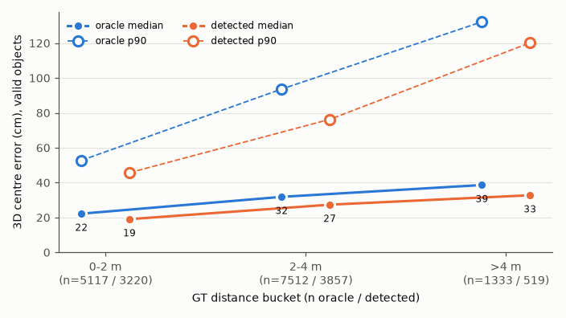
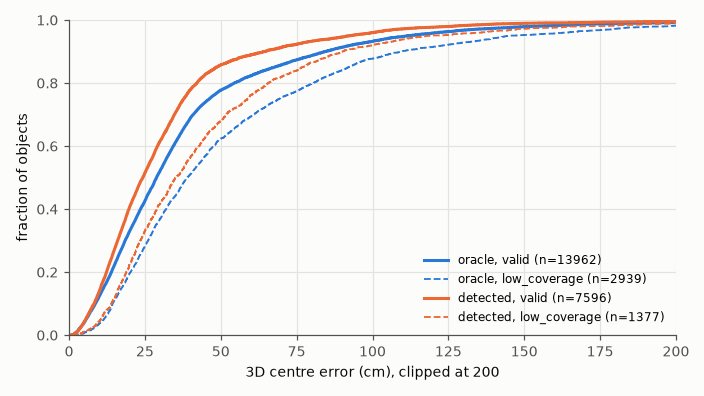

<!-- GENERATED by scripts/eval_localization.py from benchmarks/results/localization_sun_test.json. Do not edit by hand. -->

# 3D localization on SUN RGB-D test (spec 05.2; goals G3, G4)

**Measured**, one-shot, on `sunrgbd_test` (5050 images), 2026-11-11T08:08:31+00:00. All errors in cm. Nothing was tuned here: depth settings frozen on val (03.3), detections from the stored 02.2 run.

## Provenance

- Protocol `docs/evaluation_protocol.md` sha256 `58e3b4f7b07e…` (frozen, checked).
- Frozen inputs checked before the run: `depth.yaml` `9e51c8b6b95c…`, `detector.yaml` `05c49ce46d9f…`, `class_map.yaml` `2900a9d8a812…`, split `adadcd59ea80…`.
- Detections: `benchmarks/detection/sun_test_full.jsonl` at conf_operational 0.2411; run header weights sha `9b09cc8bf347…`, head one2one, imgsz 640.
- Depth: estimator A, shrink 0.7, n_min 20, tau_cov 0.3, tau_spread 0.5 m, centre k 3.0.
- git commit: none (repository has no commits yet); dirty True.

## Coverage

- 3D boxes 32170; linked GT objects in mapped classes (oracle set) 17039.
- Detections at conf_operational 18749; matched to any mapped GT 2D box 9963; matched to a linked GT object (detected set) 9024 → 0.53 of the oracle set.
- **G4:** 44812 of 44812 boxes carry a depth status (coverage 100%; asserted, the run fails otherwise). All output boxes at conf_operational: valid 0.83, low_coverage 0.15, no_depth 0.02.

## Headline (G3)

| mode | valid fraction | median | 95% CI | p90 | 95% CI | low/valid median ratio | 95% CI |
|---|---|---|---|---|---|---|---|
| oracle | 0.82 | **28.8** | 28.2–29.4 | **84.3** | 81.9–86.9 | 1.352 | 1.298–1.421 |
| detected | 0.84 | **24.3** | 23.5–25.0 | **64.2** | 61.0–67.9 | 1.443 | 1.363–1.56 |

95% CIs: percentile bootstrap, 1000 resamples of images (objects in one image share a depth map), seed 0.

## Oracle boxes

Status: valid 0.82, low_coverage 0.17, no_depth 0.01 (n=17039).

| subset | n | median | mean | p90 | Z MAE | Z RMSE | signed Z |
|---|---|---|---|---|---|---|---|
| valid, all | 13962 | 28.8 | 39.2 | 84.3 | 28.6 | 46.2 | -10.9 |
| valid, Z 0-2 m | 5117 | 22.2 | 27.6 | 52.8 | 17.5 | 28.4 | -1.6 |
| valid, Z 2-4 m | 7512 | 31.9 | 43.2 | 93.7 | 32.6 | 49.8 | -15.2 |
| valid, Z >4 m | 1333 | 38.6 | 61.4 | 132.2 | 48.9 | 72.8 | -22.8 |
| valid, kv1 | 1798 | 30.1 | 37.4 | 78.2 | 25.6 | 41.0 | -12.6 |
| valid, kv2 | 6809 | 31.4 | 43.9 | 95.6 | 32.8 | 51.1 | -12.5 |
| valid, realsense | 1546 | 27.6 | 38.2 | 84.3 | 28.2 | 43.4 | -16.1 |
| valid, xtion | 3809 | 24.7 | 32.0 | 63.4 | 22.8 | 40.0 | -5.2 |
| low_coverage, all | 2939 | 38.9 | 54.1 | 109.2 | 43.1 | 62.9 | -7.2 |

Status fractions by distance and sensor:

| subset | n | valid | low_coverage | no_depth |
|---|---|---|---|---|
| Z 0-2 m | 5582 | 0.92 | 0.08 | 0.00 |
| Z 2-4 m | 9613 | 0.78 | 0.21 | 0.01 |
| Z >4 m | 1844 | 0.72 | 0.25 | 0.03 |
| kv1 | 2114 | 0.85 | 0.15 | 0.00 |
| kv2 | 8451 | 0.81 | 0.18 | 0.01 |
| realsense | 1950 | 0.79 | 0.20 | 0.01 |
| xtion | 4524 | 0.84 | 0.16 | 0.00 |

*Analysis only, not a headline:* against the GT centre moved half the box depth toward the camera (visible-surface proxy), valid median 52.3 cm, signed Z +40.4 cm (volume centre: -10.9 cm). Links with projection IoU ≥ 0.3 only: median 25.4 cm (n=11187); 0.19 of links are below 0.3.

## Detected boxes

Status: valid 0.84, low_coverage 0.15, no_depth 0.01 (n=9024).

| subset | n | median | mean | p90 | Z MAE | Z RMSE | signed Z |
|---|---|---|---|---|---|---|---|
| valid, all | 7596 | 24.3 | 32.0 | 64.2 | 21.9 | 35.6 | -6.1 |
| valid, Z 0-2 m | 3220 | 19.1 | 24.1 | 45.7 | 15.0 | 21.7 | -0.1 |
| valid, Z 2-4 m | 3857 | 27.4 | 35.8 | 76.3 | 25.1 | 38.9 | -9.3 |
| valid, Z >4 m | 519 | 32.8 | 51.9 | 120.2 | 40.7 | 66.4 | -20.1 |
| valid, kv1 | 1049 | 27.4 | 32.8 | 67.1 | 21.2 | 32.1 | -10.4 |
| valid, kv2 | 3660 | 26.4 | 35.4 | 75.5 | 24.7 | 40.5 | -6.6 |
| valid, realsense | 894 | 22.6 | 30.8 | 61.3 | 21.0 | 34.1 | -10.0 |
| valid, xtion | 1993 | 20.5 | 25.7 | 47.8 | 17.5 | 27.7 | -1.2 |
| low_coverage, all | 1377 | 35.0 | 46.6 | 89.9 | 35.9 | 52.3 | +0.8 |

Status fractions by distance and sensor:

| subset | n | valid | low_coverage | no_depth |
|---|---|---|---|---|
| Z 0-2 m | 3487 | 0.92 | 0.08 | 0.00 |
| Z 2-4 m | 4849 | 0.80 | 0.20 | 0.01 |
| Z >4 m | 688 | 0.75 | 0.23 | 0.02 |
| kv1 | 1231 | 0.85 | 0.14 | 0.00 |
| kv2 | 4406 | 0.83 | 0.16 | 0.01 |
| realsense | 1092 | 0.82 | 0.17 | 0.01 |
| xtion | 2295 | 0.87 | 0.13 | 0.00 |

*Analysis only, not a headline:* against the GT centre moved half the box depth toward the camera (visible-surface proxy), valid median 55.5 cm, signed Z +46.7 cm (volume centre: -6.1 cm). Links with projection IoU ≥ 0.3 only: median 21.7 cm (n=6419); 0.15 of links are below 0.3.

## Val vs test (R5)

Val numbers are the 03.3 tuning results (`benchmarks/geometry/tune_val.json`, same code and settings). A gap is reported as a finding, not fixed.

| mode | split | n | valid | low | no_depth | median | p90 | signed Z | low/valid | 0-2 m | 2-4 m | >4 m |
|---|---|---|---|---|---|---|---|---|---|---|---|---|
| oracle | val | 1705 | 0.81 | 0.19 | 0.00 | 28.2 | 84.8 | -9.7 | 1.449 | 23.7 | 31.9 | 35.8 |
| oracle | test | 17039 | 0.82 | 0.17 | 0.01 | 28.8 | 84.3 | -10.9 | 1.352 | 22.2 | 31.9 | 38.6 |
| detected | val | 870 | 0.82 | 0.18 | 0.00 | 24.6 | 62.6 | -3.4 | 1.704 | 20.8 | 28.5 | 31.3 |
| detected | test | 9024 | 0.84 | 0.15 | 0.01 | 24.3 | 64.2 | -6.1 | 1.443 | 19.1 | 27.4 | 32.8 |

Share of valid objects by sensor:

| mode | split | kv1 | kv2 | realsense | xtion |
|---|---|---|---|---|---|
| oracle | val | 0.17 | 0.32 | 0.11 | 0.40 |
| oracle | test | 0.13 | 0.49 | 0.11 | 0.27 |
| detected | val | 0.17 | 0.37 | 0.10 | 0.36 |
| detected | test | 0.14 | 0.48 | 0.12 | 0.26 |

## Limitations

- The estimate is a visible-surface point; GT is the 3D box volume centre. A negative signed Z is expected and is part of the error (see the surface-corrected line, analysis only).
- GT 2D↔3D linkage is by projection + Hungarian IoU (protocol D2). Weak links may pair the wrong 3D box; the IoU ≥ 0.3 sensitivity line bounds this.
- Detected mode scores only detections matched to a linked GT object; misses and false positives are counted above, not in the error. Failure cases: spec 05.4.
- SUN RGB-D raw depth (not hole-filled); classes limited to the approved COCO mapping.
