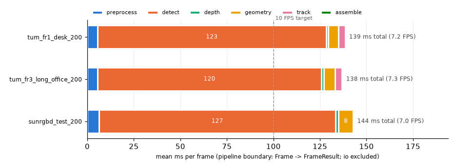

# Results summary (Phase 05)

Generated by `scripts/make_results_summary.py` from `benchmarks/results/index.json`; do not edit by hand. Every value is Measured and links to its source file. Targets are named as targets.

- Index written: 2026-11-11T09:27:56+00:00; frozen protocol sha256 `58e3b4f7b07e` (matches the index)
- Generated: 2026-11-11T09:28:06+00:00

## Goals G1-G7

| Goal | Metric | Measured | Source | Status |
|---|---|---|---|---|
| G1 back-projection exact | round trip < 1e-6 m, synthetic plane | verified by unit tests (no stored result file) | [test_geometry.py](../tests/test_geometry.py) | met (tests) |
| G2 detection baseline | SUN test mAP@[.5:.95] / AP50; P / R at conf 0.2411 | 0.228 / 0.322; 0.544 / 0.485 | [eval_baseline.json](../benchmarks/detection/eval_baseline.json) | met (documented) |
| G3 3D centre error | median / p90, valid, detected (oracle) | 0.243 / 0.642 m (0.288 / 0.843 m), n = 7596 | [localization_sun_test.json](../benchmarks/results/localization_sun_test.json) | met (measured) |
| G4 invalid depth never silent | boxes with a depth status | 44812 / 44812 (100.0%) | [localization_sun_test.json](../benchmarks/results/localization_sun_test.json) | met |
| G5 tracking stability (fr3) | static-object world std median / p90; fragmentation; jumps >0.5 m per 100 | stride 1: 0.029 / 0.148 m, 5.00, 0.178; stride 6: 0.043 / 0.188 m, 3.16, 0.764 | [eval_fr3_report.json](../benchmarks/tracking/eval_fr3_report.json) | met (measured) |
| G6 optimisation measured fairly | PyTorch vs ORT FP32 vs INT8 | not yet run | Phase 06 | pending |
| G7 demo reproducible | fresh clone + README runs the demo | not yet run | Phase 07 | pending |
| Speed (soft target 10 FPS) | lowest pipeline FPS over the 3 lists | 6.97 | [pipeline_profile.json](../benchmarks/results/pipeline_profile.json) | not met |

## Stage profile (05.3)

**Equivalence (AC2).** Live pipeline vs offline Phase 04 on fr1 (stride 1): detections identical on 573 / 573 frames, tracks identical on 573 / 573, schema errors 0. Source: [pipeline_equivalence_fr1.json](../benchmarks/results/pipeline_equivalence_fr1.json).

Label: **Measured: PyTorch CPU pipeline, local laptop**. Source: [pipeline_profile.json](../benchmarks/results/pipeline_profile.json). FPS = 1000 / mean pipeline ms (protocol section 5).

| List | detector | detect_total | depth | geometry | track | pipeline median / p95 | FPS (per run) | io |
|---|---|---|---|---|---|---|---|---|
| tum_fr1_desk_200 | 103.0 | 109.2 | 0.9 | 5.0 | 3.2 | 119.4 / 212.5 | 7.19 (7.29, 8.07, 6.40) | 20.5 |
| tum_fr3_long_office_200 | 103.1 | 108.8 | 1.2 | 4.4 | 3.7 | 121.9 / 202.7 | 7.27 (6.76, 8.33, 6.91) | 24.1 |
| sunrgbd_test_200 | 106.9 | 113.3 | 1.4 | 5.5 | 0.0 | 125.6 / 208.9 | 6.97 (6.56, 7.74, 6.71) | 26.9 |

Stage columns are pooled medians in ms over the runs.

**Bottleneck.** Lowest pipeline FPS 6.97 (target 10, soft). The target is missed. Detection (preprocess + model + postprocess) is up to 93% of the mean pipeline time; depth, geometry and tracking together are the rest. Phase 06 levers, in the order the protocol lists them: ONNX Runtime FP32, ONNX Runtime INT8 (static quantisation), the input-size sweep (imgsz 640 -> 512 / 416, with the mAP change reported), and optionally OpenVINO. No measurement boundary was moved.

## Failure categories (05.4 R1-R2)

Rule-selected SUN test cases (detected mode), categorised by eye in [failure_review.yaml](../docs/failure_review.yaml). Source: [failure_gallery.json](../benchmarks/results/failure_gallery.json).

| Category | large_error | no_depth | missed | false_positive | total |
|---|---|---|---|---|---|
| GT-box problem | 8 | 0 | 2 | 7 | 17 |
| missing or invalid depth | 0 | 8 | 0 | 0 | 8 |
| truncation | 0 | 0 | 6 | 0 | 6 |
| occluder | 2 | 0 | 0 | 0 | 2 |
| localisation | 1 | 0 | 0 | 0 | 1 |
| background bleed | 1 | 0 | 0 | 0 | 1 |
| misclassification | 0 | 0 | 0 | 1 | 1 |

**Does background bleed dominate the largest errors?** No: 1 of 12 (8.3%). The most common category there is **GT-box problem**.

- large_error: [failure_gallery_large_error.png](../benchmarks/results/failure_gallery_large_error.png)
- no_depth: [failure_gallery_no_depth.png](../benchmarks/results/failure_gallery_no_depth.png)
- missed: [failure_gallery_missed.png](../benchmarks/results/failure_gallery_missed.png)
- false_positive: [failure_gallery_false_positive.png](../benchmarks/results/failure_gallery_false_positive.png)

## Reproducibility (05.4 R3)

Source: [repro_check.json](../benchmarks/results/repro_check.json). Tolerances were fixed before the re-runs.

| Item | What | Tolerance | Result | Pass |
|---|---|---|---|---|
| sun_test_200 | per-object 3D centre error, 05.2 | +-1e-09 m | max abs diff 0 m over 925 objects | yes |
| fr3_s1_metrics | 04.2 fr3 stride-1 metrics | exact | 0 differing values | yes |
| detection_map | 02.3 SUN test mAP@[.5:.95] | +-0.001 mAP | 0.22791 vs 0.22791 (diff +0.00000) | yes |
| pipeline_median | 05.3 pipeline median per list | +-15% | tum_fr1_desk_200: 156.9 vs 119.4 ms (+31.4%); tum_fr3_long_office_200: 167.6 vs 121.9 ms (+37.5%); sunrgbd_test_200: 134.5 vs 125.6 ms (+7.1%) | NO |

- pipeline_median: 1 earlier attempt(s) kept in the file; passes: NO (start CPU 39.6%, idle no).
- pipeline_median cause (measured): the reported profile's own per-run medians already spread tum_fr1_desk_200 114.8-139.9 ms; tum_fr3_long_office_200 115.5-134.5 ms; sunrgbd_test_200 118.4-132.0 ms. One fresh run against +-15% is tighter than this laptop's run-to-run spread. The tolerance was fixed before the run and is not changed.

## Top limitations

The full list is in [risks_and_limitations.md](risks_and_limitations.md). Measured here:

1. **Ground-truth linkage limits the 3D error metric.** 19.4% of oracle and 14.8% of detected objects link to a GT 3D box with 2D IoU < 0.3; without them the detected median / p90 is 0.217 / 0.616 m (diagnostic only; the headline keeps the protocol linkage). Source: [localization_sun_test.json](../benchmarks/results/localization_sun_test.json).
2. **Screens and black surfaces give no depth.** All 8 reviewed no_depth cases are 'missing or invalid depth' (monitors, tvs, a keyboard). Source: [failure_gallery.json](../benchmarks/results/failure_gallery.json).
3. **Error grows with distance.** Detected-mode median 0.191 m at 0-2 m vs 0.328 m beyond 4 m (n = 519). Source: [localization_sun_test.json](../benchmarks/results/localization_sun_test.json).
4. **Pretrained COCO detector.** Recall of linked GT objects at conf_operational is 53.0%; many top false positives are real objects without a SUN label. Source: [localization_sun_test.json](../benchmarks/results/localization_sun_test.json), [failure_gallery.json](../benchmarks/results/failure_gallery.json).
5. **Detection is the CPU bottleneck.** Preprocess + detect is up to 92.9% of the mean pipeline time on the PyTorch CPU baseline; Phase 06 targets it. Source: [pipeline_profile.json](../benchmarks/results/pipeline_profile.json).

## Sources used

| File | sha256 (from the index) |
|---|---|
| [eval_baseline.json](../benchmarks/detection/eval_baseline.json) | `5688d6648c4d` |
| [failure_gallery.json](../benchmarks/results/failure_gallery.json) | `2651d4dc2c35` |
| [localization_sun_test.json](../benchmarks/results/localization_sun_test.json) | `7ce1a0875fd8` |
| [pipeline_equivalence_fr1.json](../benchmarks/results/pipeline_equivalence_fr1.json) | `ea6bbddfa55d` |
| [pipeline_profile.json](../benchmarks/results/pipeline_profile.json) | `08edf8bc19c3` |
| [repro_check.json](../benchmarks/results/repro_check.json) | `7ba4806ff324` |
| [eval_fr3_report.json](../benchmarks/tracking/eval_fr3_report.json) | `f17bbf842534` |
