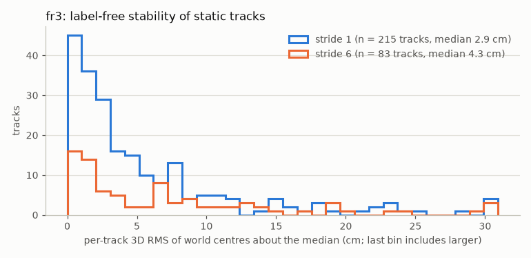
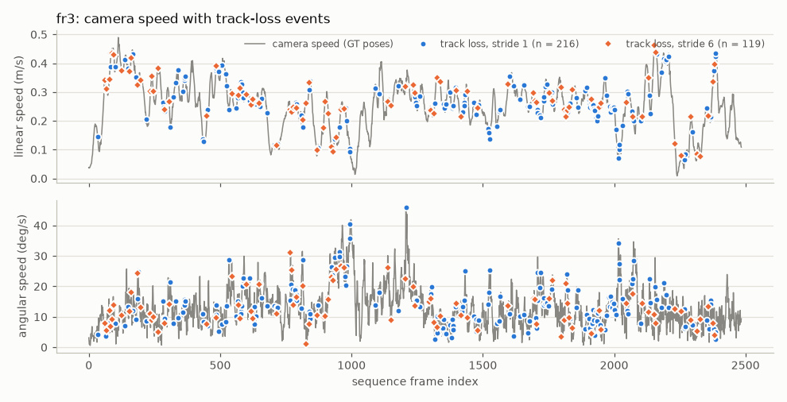

# Tracking results (Phase 04)

> Generated by `scripts/make_tracking_report.py` from `benchmarks/tracking/*.json`. Do not edit by hand.

All numbers are **measured** on TUM RGB-D with stored YOLO26-n detections (CPU), ByteTrack (Ultralytics 8.4.208) and the frozen Phase 03 depth settings. Report run: 2026-11-11T07:39:50+00:00, git commit `None` (dirty: True), tracker.yaml sha256 `883202664835`. There are **no identity labels**: every metric is a label-free proxy (evaluation protocol §4), defined before any run in spec 04.2. Tuning used fr1_desk only; fr3_long_office_household was evaluated once with the frozen configuration (R7).

## fr3_long_office_household (test split)

| metric (fr3) | stride 1 | stride 6 |
|---|---|---|
| tracker params (buffer / match / class-aware) | 60 / 0.9 / yes | 15 / 0.7 / yes |
| processed frames | 2485 | 415 |
| tracks / confirmed / static confirmed | 275 / 252 / 237 | 290 / 143 / 139 |
| mean static track length (processed frames) | 74.6 | 8.7 |
| **stability**, median (cm) | 2.9 | 4.3 |
| stability, p90 (cm) | 14.8 | 18.8 |
| tracks with >= 5 valid centres | 215 | 83 |
| **fragmentation proxy** (tracks / object) [range from inventory] | 5.00 [4.00, 6.67] | 3.16 [2.53, 4.21] |
| ID-switch proxy, d_jump = 0.50 m (sensitivity) | 0.18 (30 / 16876) | 0.76 (8 / 1047) |
| **ID-switch proxy**, jumps > 0.75 m per 100 valid pairs | 0.14 (24 / 16876) | 0.29 (3 / 1047) |
| ID-switch proxy, d_jump = 1.00 m (sensitivity) | 0.04 (7 / 16876) | 0.00 (0 / 1047) |
| **recovery** (resumed gaps / (resumed + losses)) | 0.69 (482 / 698) | 0.47 (104 / 223) |
| coverage: valid 3D share of tracked boxes | 0.965 | 0.971 |
| frames with zero tracks | 0 | 24 |

Definitions: static tracks are confirmed tracks (>= 3 matched frames) whose majority class is not movable (person, animals, balls are excluded). Stability, jumps and recovery use `valid` 3D centres of static tracks only. Jumps are counted between consecutive valid centres; recovery counts gaps after which the same ID resumed against tracks that ended for good (at least buffer + 2 processed frames before the end of the sequence). Buffer lengths are in processed frames, so at stride 6 a buffer covers 6x the time.

### Fragmentation per class (fr3)

Objects are a manual count from contact sheets (`docs/tum_object_inventory.yaml`) with their own uncertainty; the bracket in the table above is the proxy over the low/high inventory counts.

| class | objects (manual) | tracks, stride 1 | tracks, stride 6 |
|---|---|---|---|
| chair | 6 | 40 (6.67/obj) | 20 (3.33/obj) |
| bottle | 12 | 75 (6.25/obj) | 66 (5.50/obj) |
| book | 8 | 26 (3.25/obj) | 13 (1.62/obj) |
| tv | 4 | 10 (2.50/obj) | 10 (2.50/obj) |
| keyboard | 3 | 10 (3.33/obj) | 10 (3.33/obj) |
| cup | 3 | 21 (7.00/obj) | 5 (1.67/obj) |
| mouse | 3 | 21 (7.00/obj) | 8 (2.67/obj) |
| teddy bear | 1 | 5 (5.00/obj) | 4 (4.00/obj) |
| bowl | 2 | 8 (4.00/obj) | 1 (0.50/obj) |
| dining table | 2 | 4 (2.00/obj) | 2 (1.00/obj) |

### Tracker update time (R8: < 2 ms per frame median on fr1, stride 1)

| sequence | stride | isolated median (ms) | isolated p95 (ms) | < 2 ms | in-run median (ms) |
|---|---|---|---|---|---|
| fr1 (R8) | 1 | 1.70 | 2.33 | yes | 2.96 |
| fr1 | 6 | 1.39 | 2.37 | yes | 2.78 |
| fr3 | 1 | 2.60 | 4.60 | **no** | 2.46 |
| fr3 | 6 | 2.39 | 3.60 | **no** | 2.15 |

Tracker.update only (2D association, frozen per-stride settings), CPU, after a 10-frame warm-up. *Isolated* = `run_tracking.py --timing-only`: a fresh process, median of 5 tracker-only passes. *In-run* = the same measurement taken inside the full run, right after loading frames and computing 3D in the same process; it is consistently higher. Under concurrent load (other runs and an upload) the same code measured 10-12 ms, so the figure is load-sensitive. R8 is met on fr1 in isolation; on fr3 (more classes and tracks, so more per-class trackers) the tracker takes 2.4-2.6 ms, above the 2 ms budget. The class-agnostic variant takes about 0.8 ms on fr1, but it had far worse jump and stability numbers in tuning.

## Largest jumps, reviewed by eye (AC3)

The 8 largest displacements between consecutive valid world centres of one static track, per stride, whether or not they exceed d_jump. Each was looked at in the gallery (frame before | frame after, the track's box in yellow) and put in one category: **switch** (the ID moved to another physical object), **depth outlier** (same object, 3D centre wrong in one frame: background bleed, occluder, missing depth), or **pose/time** (same object and plausible depth; the displacement comes from timing or GT pose error).

**Stride 1** — gallery `benchmarks/tracking/jump_gallery_fr3_s1.jpg`

| # | track | class | seq frames | distance (m) | > d_jump | category | note |
|---|---|---|---|---|---|---|---|
| 1 | 1518 | chair | 2377 -> 2380 | 1.50 | yes | depth outlier | same chair; seat truncated at the bottom image edge, box region hits floor/background |
| 2 | 1518 | chair | 2153 -> 2159 | 1.49 | yes | depth outlier | same chair as above, same truncation at the bottom edge |
| 3 | 165 | chair | 356 -> 357 | 1.29 | yes | depth outlier | thin chair back at the right image edge; box region alternates chair and background |
| 4 | 165 | chair | 355 -> 356 | 1.16 | yes | depth outlier | same as 165 above |
| 5 | 165 | chair | 327 -> 328 | 1.10 | yes | depth outlier | same as 165 above |
| 6 | 165 | chair | 325 -> 327 | 1.09 | yes | depth outlier | same as 165 above |
| 7 | 165 | chair | 328 -> 329 | 1.04 | yes | depth outlier | same as 165 above |
| 8 | 35 | bottle | 300 -> 301 | 0.94 | yes | depth outlier | thin bottle; background bleed into the depth sample |

**Stride 6** — gallery `benchmarks/tracking/jump_gallery_fr3_s6.jpg`

| # | track | class | seq frames | distance (m) | > d_jump | category | note |
|---|---|---|---|---|---|---|---|
| 1 | 1268 | chair | 2124 -> 2130 | 0.86 | yes | depth outlier | same chair; seat truncated at the bottom edge |
| 2 | 322 | tv | 930 -> 972 | 0.84 | yes | switch | likely: a different monitor after a gap and a camera turn |
| 3 | 1268 | chair | 2112 -> 2118 | 0.82 | yes | depth outlier | same chair, bottom-edge truncation |
| 4 | 88 | bottle | 210 -> 246 | 0.70 | no | switch | green bottle -> adjacent clear bottle |
| 5 | 1244 | chair | 2376 -> 2382 | 0.63 | no | depth outlier | same chair, bottom-edge truncation |
| 6 | 1268 | chair | 2136 -> 2160 | 0.61 | no | depth outlier | same chair, bottom-edge truncation |
| 7 | 1244 | chair | 2076 -> 2166 | 0.57 | no | depth outlier | same chair after a gap, bottom-edge truncation |
| 8 | 108 | bottle | 180 -> 270 | 0.51 | no | switch | small desk bottle -> green bottle on the partition, after a 15-processed-frame gap |

Totals over both strides: depth outlier 13, switch 3.

## Camera-motion check (R5, architecture switching trigger)

Camera linear and angular speed per frame from the GT poses (central differences). Speed at track-loss events (the last observation of a confirmed static track that never resumes, with at least buffer + 2 processed frames left) is compared with the speed over all processed frames. Rule: fires if the median at losses is > 1.5x the overall median, with >= 20 loss events and a one-sided Mann-Whitney p < 0.01, for either speed.

| stride | speed | losses | median at losses | median overall | ratio | p | fires |
|---|---|---|---|---|---|---|---|
| 1 | linear (m/s) | 216 | 0.257 | 0.259 | 0.99 | 0.19 | no |
| 1 | angular (deg/s) | 216 | 13.434 | 11.583 | 1.16 | 0.00049 | no |
| 6 | linear (m/s) | 119 | 0.294 | 0.258 | 1.14 | 0.00034 | no |
| 6 | angular (deg/s) | 119 | 11.044 | 11.288 | 0.98 | 0.42 | no |

**Outcome:** the trigger does **not** fire. Track losses are not concentrated at fast camera motion by this rule, so the 2D ByteTrack association stays; 3D association (a world-frame Kalman filter) is not needed on this evidence.

## fr1_desk with the frozen settings (tuning split, for reference only)

These numbers are on the sequence the parameters were chosen on, so they are optimistic.

| metric (fr1, tuning) | stride 1 | stride 6 |
|---|---|---|
| tracker params (buffer / match / class-aware) | 60 / 0.9 / yes | 15 / 0.7 / yes |
| processed frames | 573 | 96 |
| tracks / confirmed / static confirmed | 97 / 88 / 88 | 48 / 18 / 18 |
| mean static track length (processed frames) | 28.3 | 4.8 |
| **stability**, median (cm) | 3.2 | 4.0 |
| stability, p90 (cm) | 20.2 | 5.5 |
| tracks with >= 5 valid centres | 65 | 2 |
| **fragmentation proxy** (tracks / object) [range from inventory] | 4.72 [3.54, 7.08] | 1.00 [0.75, 1.50] |
| ID-switch proxy, d_jump = 0.50 m (sensitivity) | 0.15 (3 / 1995) | 0.00 (0 / 47) |
| **ID-switch proxy**, jumps > 0.75 m per 100 valid pairs | 0.10 (2 / 1995) | 0.00 (0 / 47) |
| ID-switch proxy, d_jump = 1.00 m (sensitivity) | 0.05 (1 / 1995) | 0.00 (0 / 47) |
| **recovery** (resumed gaps / (resumed + losses)) | 0.61 (126 / 205) | 0.21 (4 / 19) |
| coverage: valid 3D share of tracked boxes | 0.835 | 0.792 |
| frames with zero tracks | 7 | 29 |

## Tuning on fr1_desk (R3)

Grid: track_buffer {15, 30, 60} (processed frames) x match_thresh {0.7, 0.8, 0.9} x class-aware / class-agnostic, at strides 1 and 6. Confidence thresholds fixed at conf_operational. Reference = the 04.1 settings (buffer 30, match 0.8, class-aware). Objective: lowest fragmentation proxy with an ID-switch proxy (d_jump = 0.75 m) no higher than the reference's; a gain smaller than 0.05 tracks per object keeps the reference. (The stock Ultralytics tracker is class-agnostic; that configuration is the `ca = no, 30, 0.8` row.)

**Stride 1.** Chosen: buffer 60, match 0.9, class-aware yes. Reason: fragmentation 6.500 -> 4.722 (>= 0.05 better) with jump rate 0.100 <= reference 0.117 per 100 valid track-frames.

| ca | buffer | match | frag. (tracks/obj) | jumps / 100 | stability med (cm) | recovery | static tracks |
|---|---|---|---|---|---|---|---|
| yes | 15 | 0.7 | 6.83 | 0.00 | 2.0 | 0.44 | 124  |
| yes | 15 | 0.8 | 6.56 | 0.00 | 2.3 | 0.41 | 122  |
| yes | 15 | 0.9 | 4.83 | 0.00 | 3.2 | 0.59 | 91  |
| yes | 30 | 0.7 | 6.83 | 0.00 | 2.0 | 0.44 | 124  |
| yes | 30 | 0.8 | 6.50 | 0.12 | 2.3 | 0.42 | 121 ref |
| yes | 30 | 0.9 | 4.78 | 0.05 | 3.2 | 0.60 | 89  |
| yes | 60 | 0.7 | 6.89 | 0.00 | 2.1 | 0.45 | 125  |
| yes | 60 | 0.8 | 6.39 | 0.12 | 2.3 | 0.45 | 119  |
| yes | 60 | 0.9 | 4.72 | 0.10 | 3.2 | 0.61 | 88 **chosen** |
| no | 15 | 0.7 | 6.67 | 0.00 | 2.1 | 0.42 | 122  |
| no | 15 | 0.8 | 5.56 | 0.06 | 2.6 | 0.40 | 103  |
| no | 15 | 0.9 | 3.72 | 0.14 | 3.7 | 0.61 | 70  |
| no | 30 | 0.7 | 6.67 | 0.00 | 2.1 | 0.43 | 122  |
| no | 30 | 0.8 | 5.44 | 0.11 | 2.7 | 0.42 | 101  |
| no | 30 | 0.9 | 3.61 | 0.19 | 3.9 | 0.64 | 67  |
| no | 60 | 0.7 | 6.72 | 0.15 | 2.4 | 0.45 | 123  |
| no | 60 | 0.8 | 5.39 | 0.11 | 2.7 | 0.44 | 100  |
| no | 60 | 0.9 | 3.50 | 0.24 | 4.1 | 0.67 | 65  |

**Stride 6.** Chosen: buffer 15, match 0.7, class-aware yes. Reason: fragmentation 1.278 -> 1.000 (>= 0.05 better) with jump rate 0.000 <= reference 1.190 per 100 valid track-frames.

| ca | buffer | match | frag. (tracks/obj) | jumps / 100 | stability med (cm) | recovery | static tracks |
|---|---|---|---|---|---|---|---|
| yes | 15 | 0.7 | 1.00 | 0.00 | 4.0 | 0.21 | 18 **chosen** |
| yes | 15 | 0.8 | 1.22 | 0.00 | 3.5 | 0.30 | 22  |
| yes | 15 | 0.9 | 1.22 | 0.00 | 3.9 | 0.44 | 23  |
| yes | 30 | 0.7 | 1.06 | 0.00 | 4.0 | 0.39 | 19  |
| yes | 30 | 0.8 | 1.28 | 1.19 | 3.5 | 0.54 | 23 ref |
| yes | 30 | 0.9 | 1.22 | 0.86 | 3.9 | 0.61 | 23  |
| yes | 60 | 0.7 | 1.06 | 0.00 | 4.0 | 0.56 | 19  |
| yes | 60 | 0.8 | 1.28 | 1.19 | 3.5 | 0.68 | 23  |
| yes | 60 | 0.9 | 1.22 | 0.86 | 3.9 | 0.74 | 23  |
| no | 15 | 0.7 | 1.22 | 3.17 | 17.2 | 0.39 | 22  |
| no | 15 | 0.8 | 1.28 | 3.92 | 27.1 | 0.46 | 23  |
| no | 15 | 0.9 | 1.28 | 4.64 | 30.3 | 0.61 | 23  |
| no | 30 | 0.7 | 1.28 | 3.08 | 17.2 | 0.52 | 23  |
| no | 30 | 0.8 | 1.28 | 2.80 | 27.1 | 0.64 | 23  |
| no | 30 | 0.9 | 1.28 | 3.85 | 28.5 | 0.72 | 23  |
| no | 60 | 0.7 | 1.28 | 3.08 | 17.2 | 0.69 | 23  |
| no | 60 | 0.8 | 1.39 | 4.50 | 27.1 | 0.78 | 25  |
| no | 60 | 0.9 | 1.28 | 3.85 | 28.5 | 0.81 | 23  |

## Limitations

- **No identity labels.** Fragmentation, jumps and recovery are proxies. A track that silently moves to a neighbouring object of the same class at similar depth is not caught by the jump proxy.
- **Static assumption.** World-frame metrics assume the objects do not move. Movable classes are excluded, but a cup or chair moved by a person in the sequence would count as instability or a jump.
- **Manual inventory.** Object counts are by eye from every 30th frame, with a stated range; small, partly visible objects (bottles, books) are the least certain, and the fragmentation proxy inherits it.
- **Jumps mix causes.** A jump can be a real ID switch or a one-frame depth outlier (background bleed, occluder). The by-eye review above separates them for the largest ones only.
- **Two sequences.** One tuning and one test sequence, both offices with a hand-held Kinect; no claim is made beyond this setting.
- **Detector errors pass through.** Misclassifications (the duck as `apple`, the cabinet as `refrigerator`) create real, consistent tracks with wrong labels; class-aware tracking also splits a track when the detector flips the class of one object.
